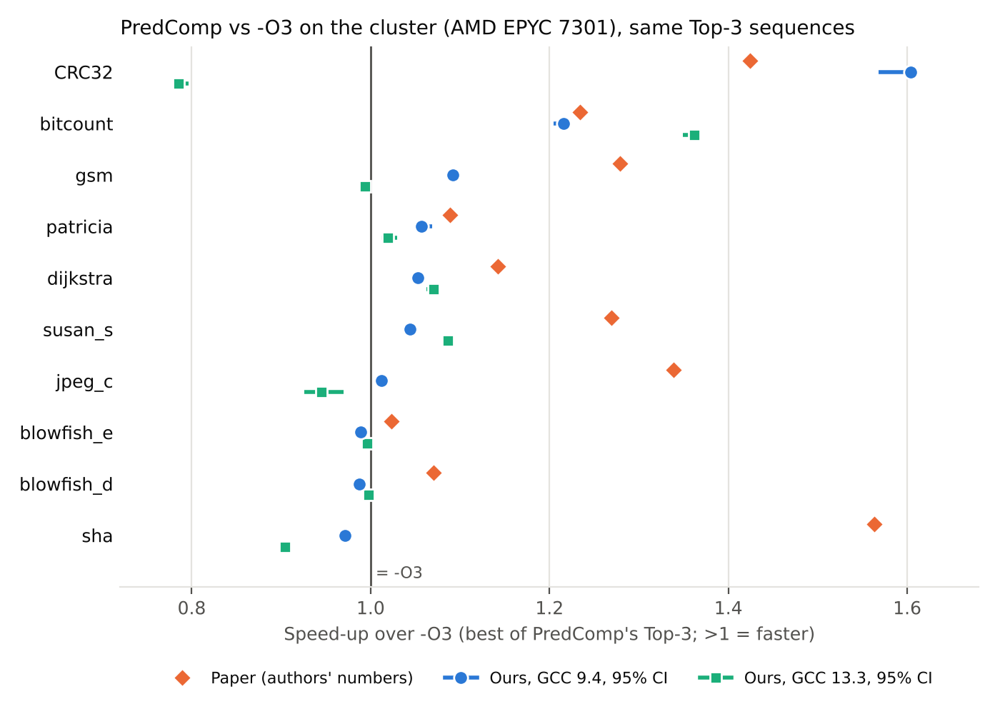

# Reproducing PredComp

Reproducibility study of **"PredComp: Predicting Compiler Optimization Options with Multi-stage Learning"**,
for the **HiPEAC Student Challenge 2027** (Option B).

- **Team:** Teodora-Alexandra Pavel, Aleksei Pankov (Sapienza University of Rome)
- **Advisor:** Prof. Alessandro Mei
- **Original code:** https://github.com/LanduBing/PredComp_taco

PredComp uses machine learning to predict a sequence of GCC optimization flags for a program, aiming to beat `-O3`.
We rebuild the authors' setup from scratch, document every problem we hit, and check whether the published speed-ups hold.

## Status

| Step | Status |
|---|---|
| Environment rebuilt (Docker, Ubuntu 20.04, GCC 9.4) | ✅ Done |
| Full pipeline running on all 10 cBench programs | ✅ Done |
| Reproducibility issues documented | ✅ 18 issues, see [docs/ISSUES.md](docs/ISSUES.md) |
| First results with the authors' measurement method (laptop) | ✅ Done |
| Rigorous measurements on native Linux (department cluster, whole node, CIs) | ✅ Done, see below |
| Same sequences with a recent compiler (GCC 13.3) | ✅ Done, see below |
| Instruction and cycle counts of the timed binaries | ✅ Done, see below |
| Exact GCC 9.2 (the paper's version) | ⬜ Optional |

## Main results

Speed-up = median time with `-O3` / median time with PredComp's sequence, measured on the DI cluster
(AMD EPYC 7301, a whole node per job) with [`scripts/measure.py`](scripts/measure.py).
"Best of Top-3" is the paper's metric: the fastest of PredComp's three predicted sequences.
Brackets: bootstrap 95% confidence interval.



| Program | Paper | Ours, GCC 9.4: Top-1 | Ours, GCC 9.4: best of Top-3 | Ours, GCC 13.3: best of Top-3 |
|---|---|---|---|---|
| telecom_CRC32 | 1.424 | 1.603 | **1.604** [1.568, 1.613] | 0.785 [0.785, 0.797] |
| automotive_bitcount | 1.234 | 1.216 | **1.216** [1.204, 1.222] | **1.362** [1.349, 1.365] |
| telecom_gsm | 1.279 | 1.092 | **1.092** [1.084, 1.096] | 0.994 [0.988, 0.997] |
| network_patricia | 1.089 | 1.048 | **1.057** [1.050, 1.069] | **1.019** [1.012, 1.030] |
| network_dijkstra | 1.142 | 0.764 | **1.053** [1.045, 1.057] | **1.070** [1.063, 1.074] |
| automotive_susan_s † | 1.269 | 1.044 | **1.044** [1.044, 1.045] | **1.086** [1.086, 1.087] |
| consumer_jpeg_c † | 1.339 | 1.012 | **1.012** [1.008, 1.014] | 0.945 [0.926, 0.970] |
| security_blowfish_e | 1.023 | 0.989 | 0.989 [0.988, 0.997] | 0.996 [0.992, 1.000] |
| security_blowfish_d | 1.070* | 0.987 | 0.987 [0.987, 0.994] | 0.998 [0.997, 0.998] |
| security_sha | 1.563 | 0.963 | 0.971 [0.965, 0.974] | 0.904 [0.901, 0.909] |
| **Mean** (keeping `-O3` when nothing beats it) | **1.243** | 1.072 | **1.108** (geo 1.096) | **1.054** (geo 1.049) |

**Bold:** significantly faster than `-O3` (the whole interval is above 1).
\*For blowfish_d, the code optimizes `bf_enc.c`, but the authors' spreadsheet lists `bf_cfb64.c`.
† GCC 9.4 values re-measured with the benchmark files on the node's local disk (job 1035857); see *Measurement notes*.
The GCC 13.3 values of these two programs were measured with the files on the shared file system.
The mean of the GCC 9.4 best-of-Top-3 column as printed, without the keep-`-O3` rule, is 1.103.
Full table: [results/final_comparison.csv](results/final_comparison.csv). Every single run: `results/cluster_*/*_raw.csv`.

**What we found**

- **GCC 9.4:** the average gain over `-O3` is about **11%, against 24% in the paper**. 7 of 10 programs are significantly faster,
  but for sha and both blowfish programs all three predictions are slower than `-O3`, and susan_s and jpeg_c gain only 4% and 1%
  (the paper reports +27% and +34%). Without CRC32 the average gain is 5%.
- **The result depends a lot on the machine.** CRC32 gives 1.60× on the cluster but 1.05× on the laptop with the same compiler and flags,
  because `-O3`'s own binary is much slower on this AMD CPU. Dijkstra goes the other way (1.30× laptop, 1.05× cluster).
- **The Top-1 prediction alone is weaker** (mean 1.072, against 1.242 in the authors' own spreadsheet): for dijkstra it is 24% *slower* than `-O3`,
  and only the third sequence helps. The paper's metric needs all three candidates to be compiled and timed.
- **The Top-3 is often fewer than 3 different programs:** for CRC32 all three sequences give the same binary, for bitcount and blowfish two do.
- **With GCC 13.3** (same sequences, no retraining) the mean drops to 1.054 and the Top-1 alone is slower than `-O3` on average (0.979).
  The gain halves (from 10.8% to 5.4%), and `-O3` is kept for 6 of the 10 programs; bitcount, susan_s, dijkstra and patricia still improve significantly.
  The gain disappeared mostly where GCC 13.3's own `-O3` got faster: CRC32's `-O3` runs in 2.18 s instead of 3.20 s (almost as fast as GCC 9.4 + PredComp, 1.99 s),
  and gsm's `-O3` is 1.11× faster (different nodes, so this is an indication, not proof).
- No predicted sequence produced the same binary as `-O3`.

**Measurement notes.** The CPU frequency (governor, turbo) cannot be controlled on the cluster; we used a whole node, pinning,
warm-ups, interleaving and many runs instead. In the first GCC 9.4 job, susan_s and jpeg_c were very noisy and slow: both write large
output files, and the benchmarks were on the cluster's shared network disk. Re-measured on the **same node with the same binaries**
but with the files on the node's local disk (job 1035857), the noise disappears (below) and the `-O3` medians fall by 1.1 s (susan_s) and 1.35 s (jpeg_c).
The table uses the re-measured values for these two. The two main jobs (1035047, 1035048) ran with an earlier version of
`cluster_measure.sh` that read the benchmarks from the home folder (shared file system); the current version always copies them to the local disk.

**Stopping rule.** Rounds stop when the 95% CI of every median is within ±1%, or after 50 rounds. Four programs reached 50 rounds
without the 1% target: CRC32 (GCC 9.4: 1.83%, GCC 13.3: 1.43%), blowfish_d (GCC 9.4: 1.26%) and jpeg_c (GCC 13.3: 2.33%).
None of their conclusions depends on this: all their speed-up intervals lie entirely above or below 1.

**Nodes.** GCC 9.4 was timed on node147, GCC 13.3 on node148 (same CPU model, AMD EPYC 7301); the instruction counts ran on node126.


### Executed instructions and cycles of the timed binaries

The CPU frequency cannot be fixed on the cluster, so, as suggested by Prof. De Sensi, we also counted the user-space
**instructions and cycles** of exactly the binaries we timed, with [`scripts/count_timed_binaries.py`](scripts/count_timed_binaries.py)
(job 1072175, exclusive node147, pinned, median of 5 interleaved runs per binary). Before counting, every saved binary is checked
against the MD5 recorded by the timing job (all 80 matched), and configurations that share a binary must agree within 1% in cycles
(they agree within 0.11%). *Instruction reduction* and *cycle ratio* = value of `-O3` / value of PredComp's best Top-3 sequence.


| Program | GCC 9.4: speed-up | instr. reduction | cycle ratio | GCC 13.3: speed-up | instr. reduction | cycle ratio |
|---|---|---|---|---|---|---|
| telecom_CRC32 | 1.604 | 0.951 | 1.661 | 0.785 | 1.000 | 0.770 |
| automotive_bitcount | 1.216 | 1.223 | 1.218 | 1.362 | 1.217 | 1.368 |
| telecom_gsm | 1.092 | 1.111 | 1.100 | 0.994 | 0.992 | 0.989 |
| network_patricia | 1.057 | 1.023 | 1.050 | 1.019 | 0.961 | 1.034 |
| network_dijkstra | 1.053 | 1.069 | 1.048 | 1.070 | 1.014 | 1.077 |
| automotive_susan_s | 1.044 | 1.221 | 1.045 | 1.086 | 1.230 | 1.088 |
| consumer_jpeg_c | 1.012 | 1.006 | 1.012 | 0.945 | 0.930 | 0.897 |
| security_blowfish_e | 0.989 | 0.988 | 0.988 | 0.996 | 0.979 | 0.994 |
| security_blowfish_d | 0.987 | 0.991 | 0.988 | 0.998 | 0.982 | 0.997 |
| security_sha | 0.971 | 0.923 | 0.947 | 0.904 | 0.890 | 0.863 |

- **Cycles confirm the speed-ups:** for the best sequence of every program, the cycle ratio agrees with the timed speed-up within 4% (GCC 9.4)
  and about 5% (GCC 13.3). Cycles count the work in clock cycles whatever the frequency, so the speed-ups are not frequency artifacts.
- **Most gains come with less executed code:** with GCC 9.4, for 7 of 10 programs the speed-up and the instruction reduction agree within about 3%.
- **CRC32 is the exception:** with GCC 9.4 PredComp's binary executes 5% *more* instructions than `-O3` but is 1.60× faster; `-O3`'s binary needs
  1.66× more cycles for fewer instructions (much lower IPC on this CPU), consistent with the gain shrinking to 1.05× on the laptop.
  With GCC 13.3 the two binaries execute the same number of instructions, but PredComp's is 21% slower.
- **susan_s:** 18–19% fewer instructions, but only 4% (GCC 9.4) and 9% (GCC 13.3) faster. Its cycle ratios (1.045, 1.088) match the speed-ups and
  user + system time covers 99% of wall time, so the gap is fewer instructions per cycle, not waiting for I/O.
- **dijkstra's Top-1** executes 8% (GCC 9.4) and 14% (GCC 13.3) more instructions and needs 33% and 29% more cycles than `-O3`.
- An earlier count (jobs 1071637/1071638) on binaries rebuilt a month later, whose GCC 13.3 MD5s differed after a compiler package update,
  gave instruction counts within 0.1% of these. Its cycles are not usable (both jobs shared one core).

Data: [results/timed_counts_vs_speedup.csv](results/timed_counts_vs_speedup.csv), `results/timed_counts_*_job1072175/` (`counts.csv`, `raw.csv`, `sanity.json`).

### First results on a laptop (authors' measurement method)

WSL2, Docker with Ubuntu 20.04 and GCC 9.4, the authors' own timing (pinned to core 0, 3 runs, no warm-up, mean only):
mean speed-up **1.106** (geometric 1.101) vs the paper's 1.243. Data: [results/wsl_docker_gcc9.4_authors_method.csv](results/wsl_docker_gcc9.4_authors_method.csv).

## How to reproduce

You need Linux (or WSL2) with Docker and git.

**1. Get this repository and the original code** (side by side):
```bash
git clone https://github.com/LexaPankov/predcomp-reproduction.git
git clone https://github.com/LanduBing/PredComp_taco.git
```

**2. Apply our code fixes** (renames `PredComp_taco` to `PredComp`, see [docs/ISSUES.md](docs/ISSUES.md)):
```bash
bash predcomp-reproduction/scripts/apply_patches.sh
```

**3. Build the environment** (10–20 minutes):
```bash
sudo docker build -t predcomp:focal predcomp-reproduction/docker
```

**4. Run PredComp** (predicts the Top-3 sequences and times them the authors' way). `--privileged` is needed so `perf` works inside the container:
```bash
sudo docker run --rm -it --privileged -v "$PWD/PredComp":/work/PredComp predcomp:focal bash
python main_test.py --bin_path /usr/bin 2>&1 | tee test_run.log   # 1 program, a few minutes
python main.py      --bin_path /usr/bin 2>&1 | tee full_run.log   # all 10 programs, 20-40 minutes
```
Files created inside the container belong to root. After `exit`, run `sudo chown -R $USER PredComp`.

**5. Measure rigorously** with the sequences from those logs (see below).

## Rigorous measurements

`scripts/measure.py` re-times PredComp's Top-3 sequences against `-O3`, following
Prof. De Sensi's advice and Hoefler & Belli (SC'15):

- the authors' own build commands, and every output checked against `-O3` before timing;
- 5 warm-up runs per configuration, not counted;
- measured runs **interleaved in a new random order every round**, so machine drift hits all configurations equally;
- every single time saved (`*_raw.csv`);
- runs continue until the 95% CI of the median is within 1% (10 to 50 rounds);
- mean, median, standard deviation, 95% CIs, and the speed-up over `-O3` with a bootstrap 95% CI (`summary.csv`);
- the MD5 of each binary, to spot sequences that produce the same program.

It only needs Python's standard library, so it runs inside the Docker image (GCC 9.4) and directly on a node (GCC 13.3).
On the department cluster (SLURM), with a whole node per job (`--exclusive`) and the benchmarks copied to the node's local disk:

```bash
cd ~/predcomp-reproduction          # logs of main.py runs in ~/logs/
sbatch scripts/cluster_measure.sh gcc9     # Ubuntu 20.04 container, GCC 9.4
sbatch scripts/cluster_measure.sh gcc13    # node's own GCC 13.3
sbatch scripts/cluster_measure.sh gcc9 --program automotive_susan_s,consumer_jpeg_c   # only some programs
sbatch scripts/cluster_count_timed.sh          # instructions + cycles of the timed binaries (both compilers)
```

## Repository layout

```
docker/Dockerfile           environment with all dependency fixes
scripts/apply_patches.sh    fixes to the original code
scripts/measure.py          rigorous timing (warm-ups, interleaving, CIs, binary check)
scripts/cluster_measure.sh  SLURM job for the cluster
scripts/count_instructions.py     executed-instruction counts with perf stat
scripts/cluster_instructions.sh   SLURM job for the earlier instruction counts
scripts/count_timed_binaries.py   instructions + cycles of the exact timed binaries (MD5-checked)
scripts/cluster_count_timed.sh    SLURM job for it
docs/ISSUES.md              the 18 reproducibility issues
results/final_comparison.csv  paper vs laptop vs cluster (GCC 9.4 and 13.3)
results/cluster_*/          every measurement of the three cluster jobs
results/instructions_*/     earlier instruction counts (rebuilt binaries)
results/timed_counts_*/     instructions + cycles of the timed binaries
results/figures/            the figures above
```
