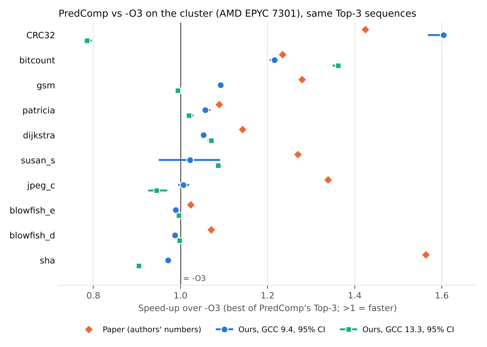
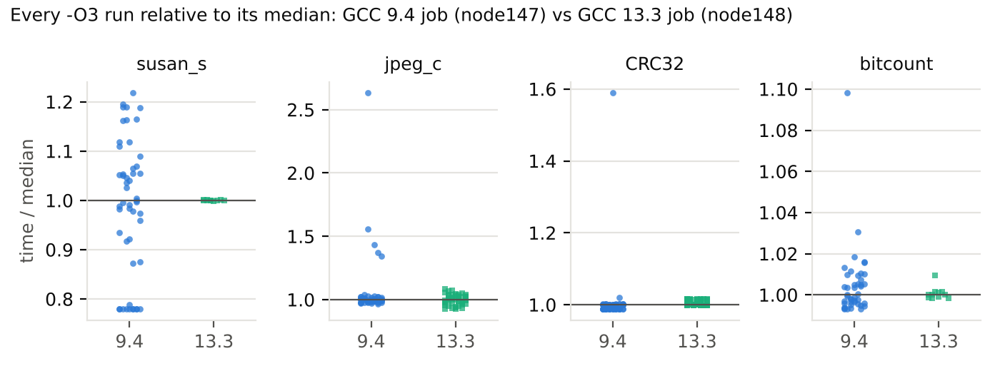

# Reproducing PredComp

Reproducibility study of **"PredComp: Predicting Compiler Optimization Options with Multi-stage Learning"**,
for the **HiPEAC Student Challenge 2027** (Option B).

- **Team:** Teodora-Alexandra Pavel, Aleksei Pankov (Sapienza University of Rome)
- **Advisor:** Prof. Alessandro Mei
- **Original code:** https://github.com/LanduBing/PredComp_taco

PredComp uses machine learning to predict a sequence of GCC optimization flags for a program, aiming to beat `-O3`.
We rebuild the authors' setup from scratch, document every problem we hit, and check whether the published speed-ups hold.

## Status

| Step | Status |
|---|---|
| Environment rebuilt (Docker, Ubuntu 20.04, GCC 9.4) | ✅ Done |
| Full pipeline running on all 10 cBench programs | ✅ Done |
| Reproducibility issues documented | ✅ 18 issues, see [docs/ISSUES.md](docs/ISSUES.md) |
| First results with the authors' measurement method (laptop) | ✅ Done |
| Rigorous measurements on native Linux (department cluster, whole node, CIs) | ✅ Done, see below |
| Same sequences with a recent compiler (GCC 13.3) | ✅ Done, see below |
| Exact GCC 9.2 (the paper's version) | ⬜ Optional |

## Main results

Speed-up = median time with `-O3` / median time with PredComp's sequence, measured on the DI cluster
(AMD EPYC 7301, a whole node per job) with [`scripts/measure.py`](scripts/measure.py).
"Best of Top-3" is the paper's metric: the fastest of PredComp's three predicted sequences.
Brackets: bootstrap 95% confidence interval.



| Program | Paper | Ours, GCC 9.4: Top-1 | Ours, GCC 9.4: best of Top-3 | Ours, GCC 13.3: best of Top-3 |
|---|---|---|---|---|
| telecom_CRC32 | 1.424 | 1.603 | **1.604** [1.568, 1.613] | 0.785 [0.785, 0.797] |
| automotive_bitcount | 1.234 | 1.216 | **1.216** [1.204, 1.222] | **1.362** [1.349, 1.365] |
| telecom_gsm | 1.279 | 1.092 | **1.092** [1.084, 1.096] | 0.994 [0.988, 0.997] |
| network_patricia | 1.089 | 1.048 | **1.057** [1.050, 1.069] | **1.019** [1.012, 1.030] |
| network_dijkstra | 1.142 | 0.764 | **1.053** [1.045, 1.057] | **1.070** [1.063, 1.074] |
| automotive_susan_s | 1.269 | 0.977 | 1.022 [0.950, 1.091] | **1.086** [1.086, 1.087] |
| consumer_jpeg_c | 1.339 | 1.007 | 1.007 [0.994, 1.020] | 0.945 [0.926, 0.970] |
| security_blowfish_e | 1.023 | 0.989 | 0.989 [0.988, 0.997] | 0.996 [0.992, 1.000] |
| security_blowfish_d | 1.070* | 0.987 | 0.987 [0.987, 0.994] | 0.998 [0.997, 0.998] |
| security_sha | 1.563 | 0.963 | 0.971 [0.965, 0.974] | 0.904 [0.901, 0.909] |
| **Mean** (keeping `-O3` when nothing beats it) | **1.243** | | **1.105** (geo 1.093) | **1.054** (geo 1.049) |

**Bold:** significantly faster than `-O3` (the whole interval is above 1).
\*For blowfish_d, the code optimizes `bf_enc.c`, but the authors' spreadsheet lists `bf_cfb64.c`.
Full table: [results/final_comparison.csv](results/final_comparison.csv). Every single run: `results/cluster_*/*_raw.csv`.

**What we found**

- **GCC 9.4:** the average gain over `-O3` is about **10%, against 24% in the paper**. Only **5 of 10 programs** are significantly faster;
  for sha and both blowfish programs all three predictions are slower than `-O3`, and for susan_s and jpeg_c there is no significant difference
  (the paper reports +27% and +34%). Without CRC32 the average gain is 5%.
- **The result depends a lot on the machine.** CRC32 gives 1.60× on the cluster but 1.05× on the laptop with the same compiler and flags,
  because `-O3`'s own binary is much slower on this AMD CPU. Dijkstra goes the other way (1.30× laptop, 1.05× cluster).
- **The Top-1 prediction alone is weaker** (mean 1.065): for dijkstra it is 24% *slower* than `-O3`, and only the third sequence helps.
  The paper's metric needs all three candidates to be compiled and timed.
- **The Top-3 is often fewer than 3 different programs:** for CRC32 all three sequences give the same binary, for bitcount and blowfish two do.
- **With GCC 13.3** (same sequences, no retraining) the mean drops to 1.054 and the Top-1 alone is slower than `-O3` on average (0.979).
  The gain mostly disappears, except for bitcount, susan_s and dijkstra.
- No predicted sequence produced the same binary as `-O3`.

**Measurement notes.** The CPU frequency (governor, turbo) cannot be controlled on the cluster; we used a whole node, pinning,
warm-ups, interleaving and many runs instead. In the GCC 9.4 job, susan_s and jpeg_c were unusually noisy (below), which is why their
intervals are wide; those two are being re-measured with the benchmark files on the node's local disk.



### First results on a laptop (authors' measurement method)

WSL2, Docker with Ubuntu 20.04 and GCC 9.4, the authors' own timing (pinned to core 0, 3 runs, no warm-up, mean only):
mean speed-up **1.106** (geometric 1.101) vs the paper's 1.243. Data: [results/wsl_docker_gcc9.4_authors_method.csv](results/wsl_docker_gcc9.4_authors_method.csv).

## How to reproduce

You need Linux (or WSL2) with Docker and git.

**1. Get this repository and the original code** (side by side):
```bash
git clone https://github.com/LexaPankov/predcomp-reproduction.git
git clone https://github.com/LanduBing/PredComp_taco.git
```

**2. Apply our code fixes** (renames `PredComp_taco` to `PredComp`, see [docs/ISSUES.md](docs/ISSUES.md)):
```bash
bash predcomp-reproduction/scripts/apply_patches.sh
```

**3. Build the environment** (10–20 minutes):
```bash
sudo docker build -t predcomp:focal predcomp-reproduction/docker
```

**4. Run PredComp** (predicts the Top-3 sequences and times them the authors' way). `--privileged` is needed so `perf` works inside the container:
```bash
sudo docker run --rm -it --privileged -v "$PWD/PredComp":/work/PredComp predcomp:focal bash
python main_test.py --bin_path /usr/bin 2>&1 | tee test_run.log   # 1 program, a few minutes
python main.py      --bin_path /usr/bin 2>&1 | tee full_run.log   # all 10 programs, 20-40 minutes
```
Files created inside the container belong to root. After `exit`, run `sudo chown -R $USER PredComp`.

**5. Measure rigorously** with the sequences from those logs (see below).

## Rigorous measurements

`scripts/measure.py` re-times PredComp's Top-3 sequences against `-O3`, following
Prof. De Sensi's advice and Hoefler & Belli (SC'15):

- the authors' own build commands, and every output checked against `-O3` before timing;
- 5 warm-up runs per configuration, not counted;
- measured runs **interleaved in a new random order every round**, so machine drift hits all configurations equally;
- every single time saved (`*_raw.csv`);
- runs continue until the 95% CI of the median is within 1% (10 to 50 rounds);
- mean, median, standard deviation, 95% CIs, and the speed-up over `-O3` with a bootstrap 95% CI (`summary.csv`);
- the MD5 of each binary, to spot sequences that produce the same program.

It only needs Python's standard library, so it runs inside the Docker image (GCC 9.4) and directly on a node (GCC 13.3).
On the department cluster (SLURM), with a whole node per job (`--exclusive`) and the benchmarks copied to the node's local disk:

```bash
cd ~/predcomp-reproduction          # logs of main.py runs in ~/logs/
sbatch scripts/cluster_measure.sh gcc9     # Ubuntu 20.04 container, GCC 9.4
sbatch scripts/cluster_measure.sh gcc13    # node's own GCC 13.3
sbatch scripts/cluster_measure.sh gcc9 --program automotive_susan_s,consumer_jpeg_c   # only some programs
```

## Repository layout

```
docker/Dockerfile           environment with all dependency fixes
scripts/apply_patches.sh    fixes to the original code
scripts/measure.py          rigorous timing (warm-ups, interleaving, CIs, binary check)
scripts/cluster_measure.sh  SLURM job for the cluster
docs/ISSUES.md              the 18 reproducibility issues
results/final_comparison.csv  paper vs laptop vs cluster (GCC 9.4 and 13.3)
results/cluster_*/          every measurement of the two cluster jobs
results/figures/            the figures above
```
